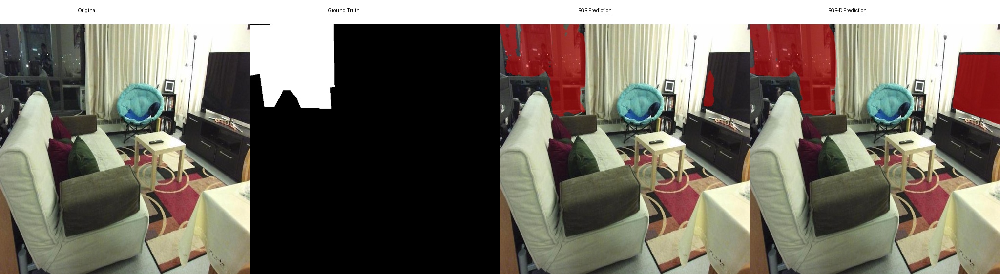
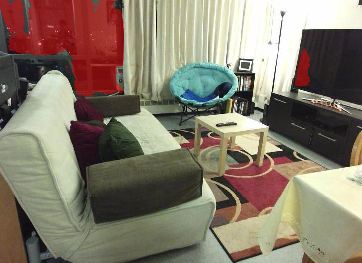
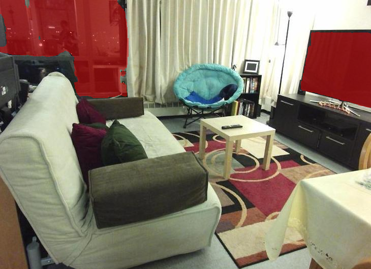

# RGB versus Early-Fusion RGB-D Glass Segmentation
### A Controlled Benchmark-to-Robot Evaluation on Pioneer P3-DX

<div align="center">


**Official implementation accompanying the research paper**

*RGB versus Early-Fusion RGB-D Glass Segmentation: A Controlled Benchmark-to-Robot Evaluation on Pioneer P3-DX*

</div>

---

# Overview

Transparent glass remains one of the most challenging materials for mobile robot perception. Unlike opaque obstacles, glass often provides limited visual texture while simultaneously transmitting and reflecting surrounding objects, making reliable detection difficult for conventional computer vision systems. Failure to recognise transparent surfaces can result in unsafe navigation, collisions, or incorrect environmental interpretation, particularly in indoor environments such as hospitals, laboratories, offices, airports, shopping centres, and industrial facilities where glass doors, partitions, and walls are increasingly common.

Recent advances in deep learning have significantly improved semantic segmentation performance using RGB imagery. At the same time, affordable depth sensors have encouraged the development of RGB-D perception systems that combine colour and geometric information. Although RGB-D approaches are widely assumed to outperform RGB-only methods, relatively few studies have isolated the contribution of depth alone while controlling for all other experimental variables. In many published comparisons, improvements attributed to depth are confounded by differences in network architecture, optimisation strategy, data augmentation, training schedules, or evaluation methodology.

This repository accompanies the research paper **"RGB versus Early-Fusion RGB-D Glass Segmentation: A Controlled Benchmark-to-Robot Evaluation on Pioneer P3-DX"**, which addresses this gap through a controlled experimental design. The study evaluates whether incorporating raw depth as a fourth input channel improves transparent glass segmentation when every other component of the perception pipeline remains unchanged.

Rather than comparing unrelated models, this work evaluates two closely matched variants of the SegFormer-B0 architecture:

- **RGB SegFormer-B0**
- **Early-Fusion RGB-D SegFormer-B0**

The RGB-D model differs from the RGB baseline only by extending the first convolutional layer to accept a fourth depth channel. All remaining architectural components, optimisation settings, training procedures, checkpoint selection criteria, and evaluation protocols are held constant throughout the study. This design isolates the effect of depth information and enables a fair assessment of its contribution to transparent glass segmentation performance.

Beyond benchmark evaluation, the trained models are deployed on a Pioneer P3-DX mobile robot to investigate whether benchmark performance translates into practical robotic perception. A lightweight semantic safety layer is incorporated into the robot's navigation pipeline, allowing predicted glass masks to trigger navigation interventions during real-world operation. This benchmark-to-robot evaluation provides practical insight into the relationship between semantic segmentation accuracy and deployment behaviour.

The repository contains the complete implementation required to reproduce the study, including training scripts, evaluation code, configuration files, deployment software, trained model checkpoints, benchmark results, qualitative visualisations, deployment outputs, and supporting documentation.

---

## Representative Comparison

<p align="center">
  
</p>

<p align="center">
  <em>Representative comparison between RGB and RGB-D segmentation predictions.</em>
</p>

# Research at a Glance

| Item | Description |
|------|-------------|
| Task | Transparent Glass Semantic Segmentation |
| Models | RGB SegFormer-B0 & Early-Fusion RGB-D SegFormer-B0 |
| Dataset | RGBD-GSD |
| Classes | Glass / Background |
| Framework | PyTorch + Hugging Face Transformers |
| Robot Platform | Pioneer P3-DX |
| Depth Sensor | Microsoft Kinect |
| Evaluation | Benchmark + Real Robot Deployment |

# Key Contributions

This repository provides:

- A fully reproducible implementation of a controlled RGB versus RGB-D transparent glass segmentation benchmark.
- An implementation of an early-fusion RGB-D SegFormer-B0 architecture using a four-channel input representation.
- Identical optimisation, training, validation, and evaluation procedures for both RGB and RGB-D models to ensure fair comparison.
- Training and evaluation pipelines for the RGB-D Glass Surface Detection (RGBD-GSD) dataset.
- Complete benchmark metrics including Pixel Accuracy, Mean Intersection-over-Union (mIoU), Precision, Recall, F1-score, and per-class IoU.
- Deployment software for integrating trained segmentation models with a Pioneer P3-DX mobile robot.
- Qualitative comparisons illustrating segmentation behaviour across representative benchmark samples.
- Representative deployment outputs demonstrating real-world semantic glass detection during robot navigation.
- Comprehensive documentation describing repository structure, experimental methodology, deployment procedures, and reproduction steps.

---

# Repository Highlights

- ✅  Controlled comparison between RGB and RGB-D perception
- ✅  Identical SegFormer-B0 backbone for both models
- ✅  Benchmark evaluation using the RGBD-GSD dataset
- ✅  Practical deployment on a Pioneer P3-DX mobile robot
- ✅  Reproducible training and evaluation pipeline
- ✅  Complete deployment framework included
- ✅  Trained model checkpoints provided
- ✅  Qualitative visualisation utilities included
- ✅  Deployment demonstrations and representative outputs provided
- ✅  Detailed documentation for reproducibility

---


## Table of Contents

- [Overview](#overview)
- [Representative Comparison](#representative-comparison)
- [Research at a Glance](#research-at-a-glance)
- [Key Contributions](#key-contributions)
- [Repository Highlights](#repository-highlights)
- [Quick Start](#quick-start)
- [Repository Structure](#repository-structure)
- [Experimental Methodology](#experimental-methodology)
- [Installation](#installation)
- [Dataset Preparation](#dataset-preparation)
- [Training](#training)
- [Model Evaluation](#model-evaluation)
- [Benchmark Results](#benchmark-results)
- [Practical Robot Deployment](#practical-robot-deployment)
- [Qualitative Analysis](#qualitative-analysis)
- [Documentation](#documentation)
- [Citation](#citation)
- [License](#license)
- [Acknowledgements](#acknowledgements)
- [Contact](#contact)

---

# Quick Start

Clone the repository

```bash
git clone https://github.com/Casmir4you/RGB-and-RGB-D-Glass-Surface-Detection-For-Safe-Pioneer-Robot-Navigation.git

cd RGB-and-RGB-D-Glass-Surface-Detection-For-Safe-Pioneer-Robot-Navigation
pip install -r requirements.txt
python src/train.py --config configs/rgb.yaml
python src/evaluate.py

For complete installation instructions, dataset preparation, deployment, and experiment configuration, continue with the sections below.
```
<details>

<summary><strong>Repository Structure (Click to Expand)</strong></summary>

# Repository Structure

The repository has been organised to provide a clear separation between configuration files, model development, deployment software, benchmark outputs, qualitative visualisations, and documentation. This modular structure allows researchers to reproduce the complete experimental pipeline, from model training on the RGBD-GSD benchmark to practical deployment on the Pioneer P3-DX mobile robot.

```
RGB-and-RGB-D-Glass-Surface-Detection-For-Safe-Pioneer-Robot-Navigation/
│
├── .gitignore
├── LICENSE
├── README.md
├── requirements.txt
│
├── configs/
├── deployment/
├── docs/
├── outputs/
├── results/
├── scripts/
└── src/
```

The repository follows the natural workflow of the research presented in the accompanying paper:

1. Configure the experiment.
2. Train the selected model.
3. Evaluate the trained checkpoint.
4. Analyse quantitative and qualitative results.
5. Deploy the trained model on the Pioneer P3-DX platform.
6. Compare benchmark performance with real-world deployment behaviour.

This structure allows each stage of the research pipeline to remain independent while sharing common configuration files and utilities.

---

# Directory Overview

## Root Directory

The repository root contains the primary project files together with the folders required for training, evaluation, deployment, documentation, and experimental results.

| Item | Description |
|------|-------------|
| `README.md` | Main project documentation and usage guide. |
| `LICENSE` | Repository license information. |
| `requirements.txt` | Python dependencies required for reproducing the experiments. |
| `.gitignore` | Files and directories excluded from version control. |

---

# configs/

The **configs** directory contains the experiment configuration files used throughout training and evaluation.

```
configs/
├── rgb.yaml
└── rgbd.yaml
```

These configuration files define the experimental settings for each model, including dataset locations, optimisation parameters, learning rate schedules, batch sizes, checkpoint settings, and evaluation options.

Maintaining separate configuration files ensures that both RGB and RGB-D experiments remain fully reproducible while keeping the training code identical across both experimental conditions.

---

# src/

The **src** directory contains the primary implementation of the semantic segmentation framework.

```
src/
│
├── train.py
├── evaluate.py
├── predict.py
│
├── datasets/
├── models/
└── utils/
```

This directory forms the core of the benchmark implementation and contains all source code required for model training, inference, and evaluation.

---

## src/datasets/

```
datasets/
└── rgbd_gsd_dataset.py
```

This module implements the RGBD-GSD dataset loader.

Its responsibilities include:

- loading RGB images,
- loading aligned depth images,
- loading segmentation masks,
- applying preprocessing,
- converting annotations into training tensors,
- supporting both RGB and RGB-D experimental configurations.

The dataset implementation allows a single codebase to support both perception modalities while ensuring that only the model input changes between experiments.

---

## src/models/

```
models/
└── segformer_rgbd.py
```

This directory contains the implementation of the modified SegFormer-B0 architecture used throughout the study.

The RGB implementation accepts the standard three-channel colour image.

The RGB-D implementation extends the first patch embedding layer to receive an additional depth channel while preserving the remainder of the SegFormer architecture unchanged.

This implementation reflects the controlled experimental methodology presented in the accompanying paper by ensuring that depth is the only architectural variable introduced into the comparison.

---

## src/utils/

```
utils/
├── config.py
├── metrics.py
├── seed.py
└── visualization.py
```

These utility modules provide reusable functionality shared across training, evaluation, and deployment.

Their responsibilities include:

- configuration loading,
- experiment reproducibility,
- random seed initialisation,
- segmentation metric computation,
- visualisation generation,
- helper functions used throughout the project.

Separating these components improves code readability while reducing duplication across the repository.

---

# scripts/

The **scripts** directory contains helper utilities used during dataset preparation, model training, evaluation, and visualisation.

```
scripts/
├── download_rgbd_gsd.py
├── export_rgbd_gsd.py
├── inspect_dataset.py
├── inspect_depth_channel.py
├── make_comparison_panels.py
├── test_loader.py
├── train_rgb.sh
├── train_rgbd.sh
└── evaluate.sh
```

These scripts automate many of the repetitive tasks required during experimentation, including:

- dataset preparation,
- dataset inspection,
- depth verification,
- training execution,
- evaluation,
- qualitative comparison generation.

Keeping these utilities separate from the core implementation improves maintainability and simplifies experiment reproduction.

---

# outputs/

The **outputs** directory stores quantitative results generated during benchmark evaluation.

```
outputs/
├── RGB/
└── RGBD/
```

Each experiment contains:

- training history,
- configuration used,
- quantitative benchmark metrics.

Typical files include:

```
history.json
config_used.json
test_metrics.json
```

These outputs provide a complete record of each experiment and support reproducibility of the reported benchmark results.

---

# results/

The **results** directory contains the final artefacts generated throughout the research project.

```
results/
│
├── experiment_summary.csv
├── final_model_summary.txt
├── comparison_panels/
├── qualitative_analysis/
│   ├── rgb/
│   └── rgbd/
│
├── Representative Terminal Output of RGB Model Practical Deployment (1).png
└── Representative Terminal Output of RGBD Model Practical Deployment (2).png
```

This directory contains the figures and summaries presented throughout the repository.

It includes:

- consolidated benchmark summaries,
- representative deployment outputs,
- qualitative segmentation comparisons,
- visual overlays,
- comparison panels generated from benchmark predictions.

Rather than recreating figures during documentation, the README and supporting documents reference these existing assets directly.

---

## comparison_panels/

```
results/comparison_panels/
```

This directory contains side-by-side comparison panels illustrating representative segmentation examples.

Each panel enables visual comparison between RGB predictions and RGB-D predictions for the same benchmark image, providing an intuitive assessment of segmentation behaviour.

---

## qualitative_analysis/

```
results/qualitative_analysis/
├── rgb/
└── rgbd/
```

This directory stores qualitative prediction outputs for both models.

Each modality contains:

- predicted segmentation masks,
- coloured overlay visualisations.

These visualisations complement the quantitative benchmark metrics by demonstrating how each model performs on representative transparent glass scenes.

---

# deployment/

The **deployment** directory contains the complete software framework used to deploy the trained segmentation models on the Pioneer P3-DX mobile robot.

Unlike many semantic segmentation repositories that conclude with benchmark evaluation, this repository extends the study into practical robotic deployment, allowing semantic predictions to influence robot navigation behaviour.

The deployment framework is described in detail later in this documentation.
</details>

---

<details>

<summary><strong>Experimental Methodology (Click to Expand)</strong></summary>

# Experimental Methodology

The experimental methodology adopted in this study was designed to isolate the contribution of depth information to transparent glass segmentation while eliminating other sources of variation. Rather than comparing different semantic segmentation architectures, optimisation strategies, or training procedures, this work evaluates two nearly identical models under controlled experimental conditions. This approach ensures that any observed performance differences can reasonably be attributed to the inclusion of depth information rather than unrelated implementation choices.

The complete experimental pipeline consists of six stages:

1. Dataset preparation
2. Model configuration
3. Model training
4. Quantitative benchmark evaluation
5. Qualitative prediction analysis
6. Practical deployment on a Pioneer P3-DX mobile robot

Each stage was performed using identical experimental settings for both RGB and RGB-D models unless the modification being investigated explicitly required otherwise.

---

# Controlled Experimental Design

Many published RGB versus RGB-D comparisons introduce multiple variables simultaneously, making it difficult to determine whether observed improvements arise from the addition of depth information or from unrelated changes such as different network architectures, loss functions, optimisation strategies, data augmentation pipelines, or training schedules.

This repository adopts a controlled experimental methodology in which the RGB model serves as the baseline while the RGB-D model differs only through the addition of a fourth input channel representing raw depth information.

The following components remain identical between both experiments:

- SegFormer-B0 backbone architecture
- Encoder and decoder design
- Dataset
- Training images
- Validation images
- Test images
- Image resolution
- Data preprocessing pipeline
- Loss function
- Optimiser
- Learning rate schedule
- Weight decay
- Mixed precision training
- Batch size
- Number of training epochs
- Early stopping strategy
- Checkpoint selection criterion
- Evaluation metrics
- Hardware platform

The only architectural modification is the extension of the first patch embedding layer from three input channels (RGB) to four input channels (RGB-D).

By maintaining all other experimental conditions unchanged, the study provides a fair comparison of RGB and RGB-D perception for transparent glass segmentation.

---

# RGB-D Early-Fusion Strategy

The RGB-D model implements an early-fusion approach in which the aligned depth image is concatenated with the RGB image before entering the neural network.

Instead of processing colour and depth independently, the model receives a single four-channel input consisting of:

```
Red
Green
Blue
Depth
```

This representation allows the transformer encoder to learn joint colour-depth feature representations from the earliest stage of the network.

To preserve compatibility with pretrained ImageNet weights, the original three-channel convolutional weights are retained while the fourth depth channel is initialised using the mean of the pretrained RGB filter weights. This enables transfer learning without discarding the knowledge already learned from large-scale natural image datasets.

Apart from this modification, the remainder of the SegFormer-B0 architecture remains unchanged.

---

# Dataset

The benchmark experiments are conducted using the RGB-D Glass Surface Detection (RGBD-GSD) dataset.

The dataset provides aligned RGB images, depth images, and pixel-level annotations for transparent glass surfaces, making it suitable for evaluating semantic segmentation models designed for glass perception.

Each sample contains:

- RGB image
- Depth image
- Binary segmentation mask

The segmentation task consists of two semantic classes:

- Glass
- Background

The repository includes scripts for dataset preparation, inspection, and export to facilitate experiment reproduction.

---

# Training Pipeline

Both models follow an identical training pipeline.

The overall workflow is illustrated below.

```
Dataset
      │
      ▼
Data Loading
      │
      ▼
Pre-processing
      │
      ▼
SegFormer-B0
(RGB or RGB-D)
      │
      ▼
Loss Computation
      │
      ▼
Backpropagation
      │
      ▼
Parameter Update
      │
      ▼
Validation
      │
      ▼
Checkpoint Selection
```

Each experiment follows the same optimisation procedure to ensure consistency throughout training.

Training includes:

- mixed precision computation,
- gradient clipping,
- learning rate warm-up,
- checkpoint monitoring,
- early stopping.

The best-performing checkpoint is selected according to validation Mean Intersection-over-Union (mIoU), ensuring that both models are evaluated using identical selection criteria.

---

# Benchmark Evaluation

After training, the selected checkpoint is evaluated on the held-out test set.

Performance is assessed using multiple complementary metrics rather than relying on a single indicator.

The benchmark reports:

- Pixel Accuracy
- Mean Intersection-over-Union (mIoU)
- Glass IoU
- Background IoU
- Precision
- Recall
- F1-score

Reporting multiple metrics provides a more complete assessment of segmentation quality by measuring both overall pixel agreement and class-specific performance.

---

# Qualitative Analysis

Quantitative benchmark metrics provide an overall measure of segmentation performance but do not fully describe model behaviour.

To complement the numerical evaluation, representative prediction examples are generated for both models.

The repository includes:

- predicted segmentation masks,
- coloured overlay visualisations,
- side-by-side comparison panels.

These visualisations allow researchers to inspect how each model responds to challenging transparent glass scenes, including variations in illumination, reflections, background clutter, and glass geometry.

Representative examples are available in:

```
results/
├── comparison_panels/
└── qualitative_analysis/
```

---

# Deployment Evaluation Method

A distinguishing feature of this repository is that the benchmark evaluation is extended to practical robotic deployment.

Instead of concluding the study after benchmark testing, both trained models are deployed on a Pioneer P3-DX mobile robot.

During deployment, incoming camera frames are processed by the semantic segmentation model to produce a binary glass mask.

The predicted mask is then passed to a lightweight semantic safety layer that determines whether a navigation intervention should be triggered.

This deployment pipeline enables investigation of an important research question:

> Does improved benchmark segmentation performance translate into safer real-world robot perception?

By combining controlled benchmark evaluation with practical deployment, the repository bridges the gap between computer vision performance metrics and robotic navigation behaviour.

---

# Reproducibility

A primary objective of this repository is to support reproducible research.

Accordingly, the repository includes:

- complete source code,
- experiment configuration files,
- training scripts,
- evaluation scripts,
- deployment software,
- trained model checkpoints,
- quantitative benchmark outputs,
- qualitative visualisations,
- representative deployment results,
- comprehensive documentation.

Researchers can therefore reproduce the complete experimental pipeline—from model training through to real-world deployment—using the resources provided within this repository.
</details>

---


# Installation

This repository was developed and tested using Python 3.11 together with PyTorch and the Hugging Face Transformers library. The implementation is platform-independent and can be executed on Windows or Linux systems equipped with a CUDA-compatible NVIDIA GPU. Although CPU execution is supported, GPU acceleration is strongly recommended due to the computational requirements of semantic segmentation training.

---

# System Requirements

The following hardware configuration is recommended for reproducing the benchmark experiments.

| Component | Recommendation |
|-----------|---------------|
| Operating System | Windows 10/11 or Ubuntu 22.04+ |
| Python | 3.11 |
| GPU | NVIDIA CUDA-compatible GPU |
| CUDA | CUDA 12.x |
| RAM | Minimum 16 GB |
| Storage | At least 20 GB free space |

The deployment framework additionally requires a Pioneer P3-DX mobile robot together with a Microsoft Kinect depth camera for real-world experiments.

---

# Clone the Repository

Clone the repository from GitHub.

```bash
git clone https://github.com/Casmir4you/RGB-and-RGB-D-Glass-Surface-Detection-For-Safe-Pioneer-Robot-Navigation.git

cd RGB-and-RGB-D-Glass-Surface-Detection-For-Safe-Pioneer-Robot-Navigation
```

---

# Create a Python Virtual Environment

A dedicated virtual environment is recommended to avoid dependency conflicts.

### Windows

```bash
python -m venv venv

venv\Scripts\activate
```

### Linux

```bash
python3 -m venv venv

source venv/bin/activate
```

---

# Install Dependencies

Install all required Python packages using the supplied requirements file.

```bash
pip install -r requirements.txt
```

After installation, verify that PyTorch can detect your CUDA-enabled GPU.

```python
import torch

print(torch.cuda.is_available())
print(torch.cuda.get_device_name(0))
```

A successful installation should report your available NVIDIA GPU.

---

# Repository Configuration

Experiment configurations are stored in

```
configs/
```

Two configuration files are provided.

```
configs/
├── rgb.yaml
└── rgbd.yaml
```

These files specify:

- dataset locations
- batch size
- learning rate
- optimiser settings
- checkpoint paths
- training parameters
- evaluation parameters

Researchers can reproduce the published experiments directly using these configuration files or modify them to investigate alternative experimental settings.

---

# Dataset Preparation

The repository uses the RGB-D Glass Surface Detection (RGBD-GSD) dataset.

For licensing reasons, the dataset is **not included** within this repository.

After downloading the dataset, organise it according to the directory structure expected by the dataset loader.

The dataset preparation utilities are located in

```
scripts/
```

Available helper scripts include

```
download_rgbd_gsd.py

export_rgbd_gsd.py

inspect_dataset.py

inspect_depth_channel.py
```

These utilities assist with dataset preparation and verification prior to model training.

---

# Inspecting the Dataset

Before training, it is recommended to verify that the RGB images, depth images, and segmentation masks are correctly aligned.

Run

```bash
python scripts/inspect_dataset.py
```

to inspect representative samples.

Depth images may also be examined independently using

```bash
python scripts/inspect_depth_channel.py
```

Verifying the dataset before training helps identify missing files, incorrect directory structures, or alignment issues that could adversely affect model performance.

---

# Training

The repository provides independent configurations for RGB and RGB-D experiments while sharing the same training implementation.

The training workflow is illustrated below.

```
Configuration File
        │
        ▼
 Dataset Loader
        │
        ▼
SegFormer Model
        │
        ▼
 Loss Function
        │
        ▼
 Optimiser
        │
        ▼
 Validation
        │
        ▼
Best Checkpoint
```

The common training script is located in

```
src/train.py
```

---

## Training the RGB Model

The RGB baseline model can be trained using

```bash
python src/train.py --config configs/rgb.yaml
```

Alternatively,

```bash
bash scripts/train_rgb.sh
```

may be used on systems supporting shell scripts.

---

## Training the RGB-D Model

The RGB-D model can be trained using

```bash
python src/train.py --config configs/rgbd.yaml
```

or

```bash
bash scripts/train_rgbd.sh
```

The RGB-D configuration extends the RGB baseline by introducing a fourth input channel corresponding to the aligned depth image.

No additional architectural changes are introduced beyond this modification.

---

# Training Outputs

During training, experiment outputs are automatically stored within

```
outputs/
```

Each experiment generates a dedicated directory.

```
outputs/

├── RGB/

└── RGBD/
```

Typical output files include

```
config_used.json

history.json

test_metrics.json
```

These files provide a permanent record of the experiment configuration, optimisation history, and quantitative evaluation metrics.

---

# Model Evaluation

The trained checkpoints can be evaluated independently using

```bash
python src/evaluate.py
```

or

```bash
bash scripts/evaluate.sh
```

Evaluation computes all benchmark metrics reported in the accompanying paper.

These include

- Pixel Accuracy
- Mean Intersection-over-Union (mIoU)
- Precision
- Recall
- F1-score
- Per-class IoU

The resulting metrics are saved automatically within the experiment output directory.

---

# Inference

Inference on individual images can be performed using

```
src/predict.py
```

This script loads a trained checkpoint, performs semantic segmentation, and generates predicted glass masks for unseen images.

Predictions may subsequently be visualised using the visualisation utilities contained within

```
src/utils/
```

or incorporated into the qualitative comparison pipeline.

---

# Generating Qualitative Comparisons

Representative qualitative visualisations can be generated using

```
scripts/make_comparison_panels.py
```

The generated figures are stored in

```
results/comparison_panels/
```

Additional RGB and RGB-D overlay visualisations are available in

```
results/qualitative_analysis/
├── rgb/
└── rgbd/
```

These figures provide an intuitive visual comparison of segmentation behaviour across representative benchmark images and complement the quantitative evaluation metrics reported throughout the study.

---

# Benchmark Results

The controlled experimental evaluation compared an RGB SegFormer-B0 model with an early-fusion RGB-D SegFormer-B0 model using identical training procedures, optimisation settings, checkpoint selection criteria, and evaluation protocols. The only architectural modification between the two models was the addition of a fourth depth channel in the RGB-D implementation.

The benchmark results demonstrate that the RGB baseline achieved slightly stronger overall segmentation performance on the RGBD-GSD test set, while the RGB-D model produced marginally higher precision. These findings suggest that simply introducing raw depth information through early fusion does not necessarily improve transparent glass segmentation performance under controlled experimental conditions.

## Quantitative Performance

| Metric | RGB | RGB-D |
|---------|-----:|------:|
| Pixel Accuracy | **0.9448** | 0.9428 |
| Mean IoU | **0.8234** | 0.8158 |
| Glass IoU | **0.7108** | 0.6983 |
| Background IoU | **0.9360** | 0.9334 |
| Precision | 0.8247 | **0.8276** |
| Recall | **0.8376** | 0.8191 |
| F1 Score | **0.8310** | 0.8233 |

The benchmark indicates that both models achieve strong segmentation performance; however, the RGB model consistently provides higher overlap with the ground-truth glass regions and achieves better overall balance between precision and recall.

---

# Experimental Summary

The controlled design of the study allows several important conclusions.

- Both models achieved high semantic segmentation accuracy.
- RGB slightly outperformed RGB-D on the benchmark dataset.
- RGB-D produced slightly higher precision but lower recall.
- Benchmark improvements did not automatically translate into improved deployment behaviour.
- The addition of raw depth information alone was insufficient to consistently improve transparent glass segmentation.

These findings demonstrate the importance of controlled experimentation when evaluating multimodal perception systems.

---

# Practical Robot Deployment

Unlike many semantic segmentation repositories, this project extends beyond benchmark evaluation by validating the trained models during real-world deployment on a Pioneer P3-DX mobile robot.
## RGB Model Deployment

<p align="center">


</p>

<p align="center">
<em>Representative terminal output from deployment of the RGB model.</em>
</p>


## RGB-D Model Deployment

<p align="center">


</p>

<p align="center">
<em>Representative terminal output from deployment of the RGB-D model.</em>
</p>

The deployment pipeline integrates semantic segmentation into the robot perception system through a lightweight semantic safety layer. Incoming RGB or RGB-D frames are processed by the trained model to produce binary glass masks. The predicted masks are subsequently analysed to determine whether navigation intervention should be triggered.

The deployment framework is located within

```
deployment/
```

and includes

```
kinect_capture.py

navigation.py

robot_controller.py

rgb_inference.py

rgbd_inference.py

pioneer_rgb_deployment.py

pioneer_rgbd_deployment.py
```

together with deployment-specific configuration files and trained model checkpoints.

---

# Deployment Performance

Practical deployment demonstrates that benchmark performance alone does not fully characterise perception behaviour in robotic systems.

Across representative deployment trials:

- Both models successfully detected transparent glass in practical environments.
- Neither model generated false detections during representative non-glass navigation scenarios.
- The RGB model produced more consistent semantic trigger behaviour than the RGB-D implementation.
- RGB maintained lower inference latency, making it better suited for real-time deployment.

These observations reinforce the importance of evaluating perception algorithms under realistic operating conditions rather than relying exclusively on benchmark metrics.

---

# Representative Deployment Outputs

Representative terminal outputs from practical deployment are available within

```
results/

├── Representative Terminal Output of RGB Model Practical Deployment (1).png

└── Representative Terminal Output of RGBD Model Practical Deployment (2).png
```

These examples illustrate the complete deployment pipeline from camera acquisition through semantic inference to navigation decision making.

---

# Qualitative Analysis

Quantitative metrics provide a numerical summary of segmentation performance, while qualitative analysis enables visual assessment of model behaviour.

## Representative RGB Prediction

<p align="center">
  
</p>

<p align="center">
  <em>Representative segmentation output produced by the RGB model.</em>
</p>

## Representative RGB-D Prediction

<p align="center">
  
</p>

<p align="center">
  <em>Representative segmentation output produced by the early-fusion RGB-D model.</em>
</p>


Additional representative prediction overlays for both RGB and RGB-D models are available in

```
results/

└── qualitative_analysis/

    ├── rgb/

    └── rgbd/
```

Each directory contains

- predicted segmentation masks,
- coloured prediction overlays,
- representative benchmark examples.

These visualisations allow researchers to examine how each model responds to challenging transparent glass scenes under varying lighting conditions, reflections, and background complexity.

---

# Side-by-Side Comparison Panels

Direct visual comparisons between RGB and RGB-D predictions are provided in

```
results/comparison_panels/
```

Each comparison panel presents corresponding predictions from both models for the same benchmark image, allowing qualitative assessment alongside the reported benchmark metrics.

---

# Documentation

Additional documentation is available within the `docs/` directory.

| Document | Description |
|----------|-------------|
| `methodology.md` | Detailed explanation of the controlled experimental design. |
| `repository-structure.md` | Comprehensive overview of the repository organisation. |
| `installation.md` | Environment setup and dependency installation. |
| `experiments.md` | Training and evaluation workflow. |
| `deployment.md` | Pioneer P3-DX deployment framework. |
| `results.md` | Detailed interpretation of benchmark and deployment results. |

---

# Citation

If you use this repository in your research, please cite the accompanying paper.

```bibtex
@misc{amasiatu2026rgbdglass,
  title        = {RGB versus Early-Fusion RGB-D Glass Segmentation: A Controlled Benchmark-to-Robot Evaluation on Pioneer P3-DX},
  author       = {Ebubechukwu Amasiatu and Salem Ameen},
  year         = {2026},
  note         = {Manuscript under review}
}
```

Once your paper is published, replace the above entry with the final DOI and publication details.

---

# License

This project is released under the MIT License.

See the `LICENSE` file for further information.

---

# Acknowledgements

The author gratefully acknowledges:

- Birmingham City University
- The School of Engineering and the Built Environment
- The developers of SegFormer
- Hugging Face Transformers
- PyTorch
- The RGBD-GSD dataset authors
- The Pioneer P3-DX robotics platform
- Microsoft Kinect depth sensing technology

Their contributions made this research possible.

---

# Contact

For questions, suggestions, or collaboration opportunities, please open an issue within this repository or contact the repository owner through GitHub.

Repository:

**https://github.com/Casmir4you/RGB-and-RGB-D-Glass-Surface-Detection-For-Safe-Pioneer-Robot-Navigation**

---


## Support the Project

If you find this repository useful for your research, please consider:

- ⭐ Starring the repository
- 📖 Citing the accompanying paper
- 🤝 Opening an issue with questions or suggestions

<div align="center">

**Thank you for your interest in this work.**

</div>