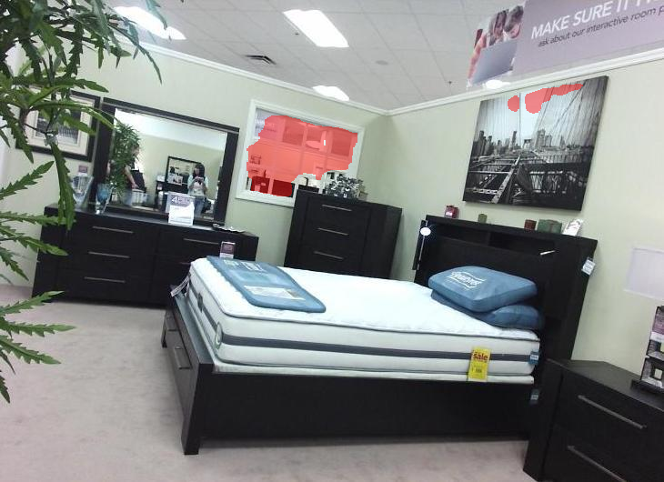
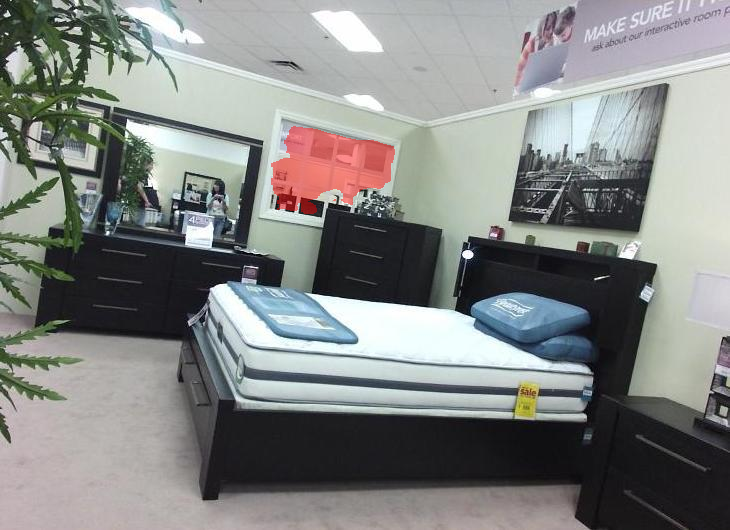

# Results and Interpretation

## Held-Out Test Results

| Metric | RGB | RGB-D |
|---|---:|---:|
| Pixel Accuracy | **0.9429** | 0.9408 |
| Mean IoU | **0.8152** | 0.8085 |
| Glass IoU | **0.6961** | 0.6850 |
| Background IoU | **0.9344** | 0.9321 |
| Glass Precision | **0.8358** | 0.8333 |
| Glass Recall | **0.8063** | 0.7938 |
| Glass F1-score | **0.8208** | 0.8131 |

## Quantitative Interpretation

The RGB model achieved slightly higher values across all reported held-out test metrics.

The results support three main conclusions:

1. Both models achieved strong segmentation performance.
2. The four-channel RGB-D SegFormer was successfully trained and deployed.
3. Depth information did not improve held-out test performance under the evaluated conditions.

Potential contributing factors include unreliable or missing depth measurements on transparent surfaces, sensor noise, additional multimodal learning complexity, and limited dataset diversity. These are plausible interpretations rather than experimentally isolated causes.

## Representative Four-Panel Comparison

The panel shows:

1. original RGB image
2. ground-truth glass mask
3. RGB prediction
4. RGB-D prediction

The RGB prediction captures much of the labelled glass region but also includes some false-positive areas. The RGB-D output identifies the principal glass region but is more conservative in this sample.

## Representative RGB Overlay

The RGB overlay shows the predicted glass region highlighted over the original scene.

## Representative RGB-D Overlay

The RGB-D overlay presents the corresponding multimodal prediction for the same scene.

## Deployment Evidence

### RGB

### RGB-D

Both representative runs show live sensor input and a robot response in which movement is stopped after glass is detected.

## Limitations

- evaluation on one public dataset
- deployment on one robotic platform
- binary glass segmentation only
- dependence on one RGB-D sensor family
- perception-focused evaluation
- no complete evaluation of SLAM, path planning, or obstacle avoidance

## Future Directions

- evaluation on additional transparent-object datasets
- alternative RGB-D sensors
- improved multimodal fusion strategies
- domain adaptation for deployment environments
- embedded or edge inference optimisation
- integration with a fully evaluated autonomous navigation stack
